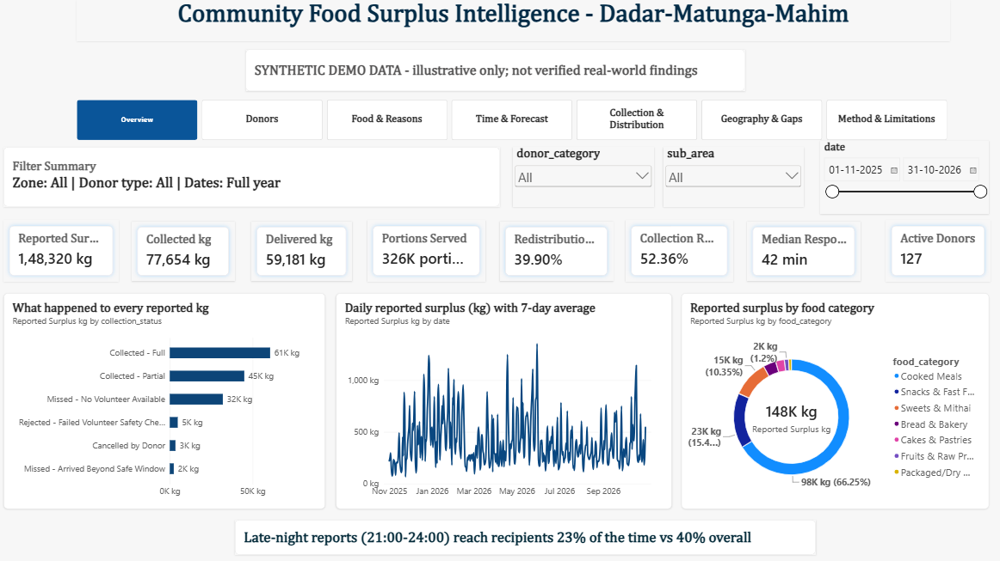
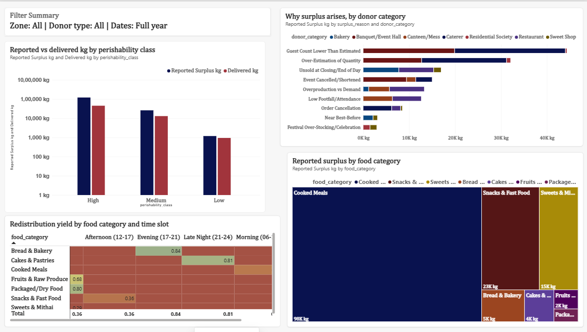
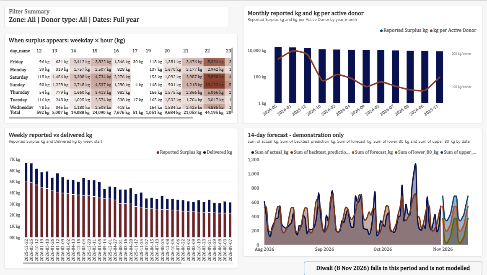
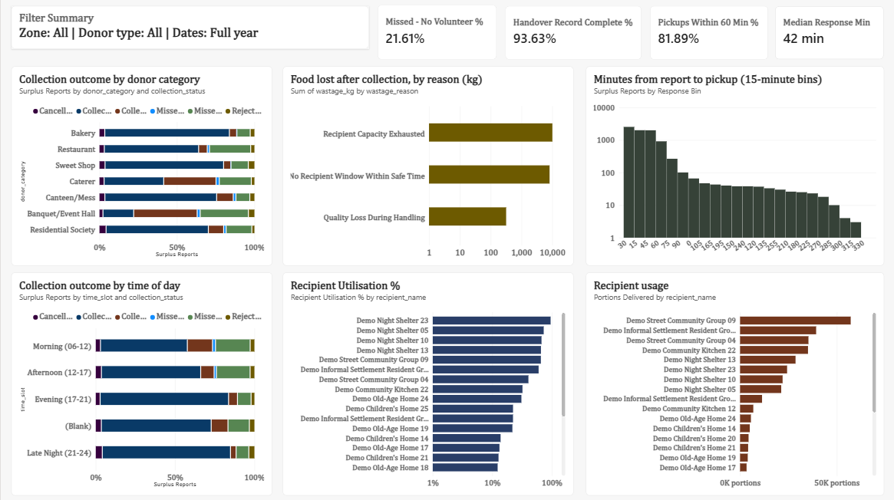
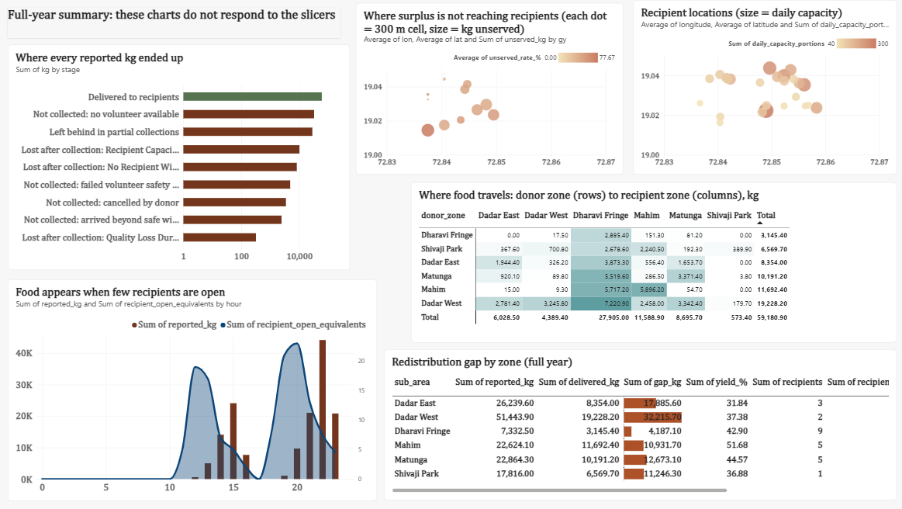

# Community Food Surplus Intelligence and Redistribution Analysis System
**Study area:** Dadar - Matunga - Mahim (+ Dharavi fringe), Mumbai | **Type:** Data Science / research / social-impact project (no web app)

> ## SYNTHETIC DEMO DATA
> All donors, NGOs, volunteers and records in this repository are **fictional and generated by a simulator**. No NGO partnership, access or
> endorsement is claimed. Results demonstrate the method; they are **not verified real-world findings**. Real field data must be collected with
> the templates in `data/templates/` and kept separate. The system never makes food-safety decisions - trained humans do.

## What it does
Models the chain **donor surplus report -> volunteer collection -> recipient distribution** and answers: how much surplus appears, who/what/why/when, how efficiently it is
collected and delivered, where and when the redistribution gaps are, which donor behaviour segments exist, whether surplus can be forecast, and which practical
changes would raise redistribution yield. Headline demo result: ~148 t reported, ~40% delivered end-to-end; biggest losses = missing late-night volunteers, load-capacity partial pickups and no recipient open (or capacity left) late at night.

## Realism (no surveys needed)
The data are synthetic but **calibrated to public evidence**: 2026 festival calendar, Mumbai's 2026 monsoon pattern (late onset, very wet July), FSSAI holding-time/temperature guidance (cooked food 4-6 h),
G North ward population and slum share, Feeding India / university studies for event and canteen surplus, and UNEP's food-waste benchmark for a scale check.
Every parameter is listed with source and status (*Sourced / Adapted / Assumption*) in `data/calibration_sources.csv` and `docs/07_realism_and_calibration.md`.

## Folder structure
```
food_surplus_project/
|-- README.md  LICENSE  requirements.txt  run_all.sh  .gitignore  .gitattributes
|-- data/
|   |-- raw/                7 relational CSVs (SYNTHETIC DEMO DATA, light formatting noise)
|   |-- clean/              cleaned tables + master_surplus / master_distribution
|   |-- templates/          blank FIELD DATA templates + allowed_values_lookup.csv
|   |-- data_dictionary.csv
|   `-- calibration_sources.csv   sources and confidence label for every calibrated parameter
|-- scripts/                00..08 tested scripts, common.py, schema.py, build_notebooks.py
|-- notebooks/              executed notebooks generated from the scripts (02, 03, 04, 05)
|-- outputs/
|   |-- figures/            15 analysis charts (PNG)
|   `-- tables/             all statistical results (CSV)
|-- powerbi/
|   |-- data/               star schema CSVs for Power BI
|   `-- Food_Surplus_Dashboard.pbix
|-- docs/
|   |-- 01_area_selection_and_scope.md   02_methodology.md   03_fssai_safety_and_ethics.md
|   |-- 04_findings_and_limitations.md   05_recommendations_and_pilot.md
|   |-- 06_powerbi_dashboard_guide.md    07_realism_and_calibration.md
|   `-- images/             dashboard screenshots used in this README
`-- surveys/                consent note, donor / recipient / volunteer questionnaires, field checklist
```

## Setup
```bash
python -m venv .venv && source .venv/bin/activate      # Windows: .venv\Scripts\activate
pip install -r requirements.txt
bash run_all.sh               # everything, ~1-2 min  (add --notebooks to rebuild the executed notebooks)
# or step by step:  python scripts/01_generate_data.py  ->  02  ->  03  ->  04  ->  05  ->  06_tests.py
```
Tested with Python 3.12, pandas 3.0, NumPy 2.5, scikit-learn 1.9, statsmodels 0.15. Seeded (2026): regenerating gives byte-identical CSVs.

## Datasets (7 tables, 10,302 surplus reports, 12 months)
`donors` (128) - `recipients` (25) - `volunteers` (36) - `daily_context` (365) - `surplus_records` (10,302) - `collections` (10,302, one per report) - `distributions` (9,100).
See `data/data_dictionary.csv` (89 documented columns). 73 validation checks pass; `06_tests.py` proves the validator rejects corrupted data.

## Analyses
Cleaning and validation - KPIs - descriptive statistics - food/donor/reason analysis - daily/weekly/monthly trends - collection and distribution efficiency -
hypothesis tests with effect sizes - logistic model - redistribution-gap decomposition - K-Means donor segmentation (accepted only if silhouette >= 0.25 and stable) -
back-tested forecasting (must beat naive baselines) - grid hotspot analysis with Moran's I - indicative impact scenarios.

## Dashboard preview
All figures below are SYNTHETIC DEMO DATA. The Power BI file is powerbi/Food_Surplus_Dashboard.pbix (open in Power BI Desktop).

## Overview


## Food & Reasons


## Time & Forecast


## Collection & Distribution


## Geography & Graphs


## Power BI
Open `docs/06_powerbi_dashboard_guide.md`: load `powerbi/data/*.csv`, apply the theme, paste `measures.dax`, build the 7 pages. (A `.pbix` needs Power BI Desktop and is not included.)

## Using real data
Fill the templates in `data/templates/` (after consent and ethics approval), put them in a new `data/field/` folder, and point the scripts at it; keep SYNTHETIC and FIELD data in separate tables.
Proposed supervised pilot with an **authorised, verified** NGO partner: `docs/05_recommendations_and_pilot.md`.

## Limitations (short)
Synthetic data encode the assumptions of their generator; one annual cycle only; approximate coordinates and festival dates; donor-reported quantities; simplified logistics. Full list: `docs/04_findings_and_limitations.md`.
